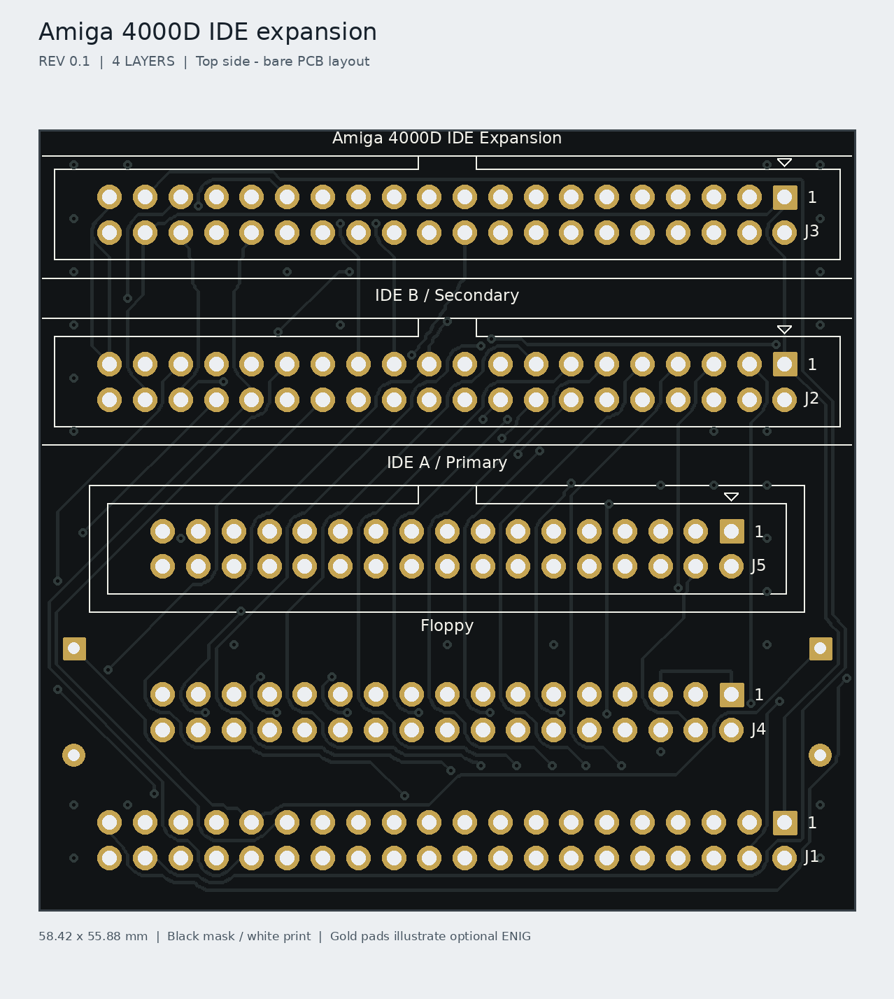
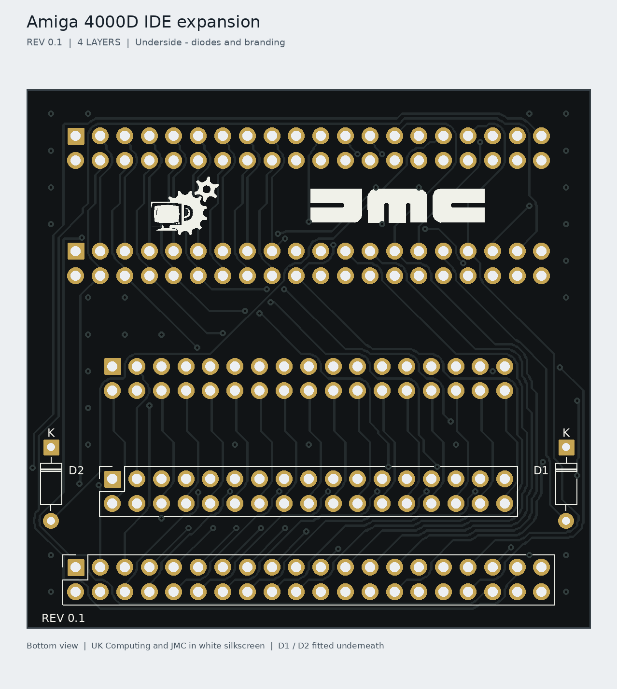

# Amiga 4000D IDE Expansion

A compact IDE expansion and floppy pass-through PCB for the **Amiga 4000 Desktop**, built to match a **black PCB, white silkscreen and gold exposed-pad** appearance. Current revision: **0.1**.

Project collaboration: **Paul of UK Computing Limited**, **Jon of JMC Electronics**, and **AI assistance through Codex**.

The board provides two 40-pin IDE outputs, each intended for a master and slave device, plus a 34-pin floppy pass-through. The two motherboard sockets and both interrupt diodes fit underneath.

**Status, 26 October 2026:** Paul reports that revision 0.1 has been submitted for PCB fabrication. No assembled board, physical fit or operation in an Amiga has yet been verified.

For engineering or AI work, start with [AGENTS.md](AGENTS.md), the [current handover](docs/AI-HANDOVER.md) and the [documentation index](docs/README.md).




These are unpopulated CAD appearance previews. The gold pads illustrate ENIG. Connector bodies are omitted to show the printing and pads.

## PCB and files

Open [Amiga4000_IDE_Expansion.kicad_pro](Amiga4000_IDE_Expansion.kicad_pro) in **KiCad 7.0 or newer**. Embedded symbols and project-local footprints are included.

| Property | Revision 0.1 |
|---|---|
| Outline | **58.42 × 55.88 mm** |
| Nominal PCB thickness | **1.6 mm** |
| Copper layers | **Four** |
| F.Cu | Front signals and pads |
| In1.Cu | Ground plane |
| In2.Cu | Ground plane |
| B.Cu | Rear signals and pads |
| Track / minimum copper clearance | **0.254 / 0.200 mm** |
| Through vias | **0.60 mm diameter / 0.30 mm drill** |
| Connector / diode drills | **1.00 / 0.80 mm** |
| Connector pitch | **2.54 mm**, between columns and rows |
| Motherboard IDE-to-floppy centre spacing | **9.144 mm**, with lengthwise centres aligned |

The board is nominally just narrower than the selected standard 40-pin header body outline. Actual connector dimensions, matching socket heights, diode clearance and drive-cage clearance still need checking.

## Connectors and parts

| Reference | Qty | Function | Fitted side |
|---|---:|---|---|
| J1 | 1 | Motherboard IDE, female 2×20 PCB socket | Bottom |
| J2 | 1 | IDE A / Primary, male 2×20 IDC box header | Top |
| J3 | 1 | IDE B / Secondary, male 2×20 IDC box header | Top |
| J4 | 1 | Motherboard floppy, female 2×17 PCB socket | Bottom |
| J5 | 1 | Floppy pass-through, male 2×17 IDC box header | Top |
| D1, D2 | 2 | 1N4148 axial DO-35 diodes, 7.62 mm lead spacing | Bottom |

Use the [BOM](BOM.csv) and [assembly guide](docs/ASSEMBLY.md). J1 and J4 must have the **same mating height** and seat together without bending the motherboard or expansion PCB. Manufacturer part numbers have not yet been approved.

## IDE operation

| Output | Intended device arrangement |
|---|---|
| IDE A / Primary | Master and slave on one IDE cable |
| IDE B / Secondary | Master and slave on a second IDE cable |

Data and most control signals share the motherboard bus. The host select signals distinguish the two device pairs. D1 and D2 combine the channels' interrupt outputs while isolating them from one another. Compatible four-device IDE software is required for the secondary channel; OS, driver, boot and device combinations remain to be tested.

This is an unbuffered interface. Keep cables short and configure drives explicitly as master or slave. Drives and CF adapters need their normal separate power supply. See the [electrical notes](docs/ELECTRICAL.md) for the deliberate pin exceptions, including output pin 38. No DMA or performance claim is made.

The floppy connector passes all 34 positions through and provides a second mechanical support point. It does not decode IDE channel selection.

## Manufacturing

The [revision 0.1 manufacturing ZIP](fabrication/REV0.1/A4000D_IDE_Expansion_Rev0_1_Gerbers.zip) is the exact ZIP supplied for the submitted PCB, with a descriptive filename. Its bytes are retained unchanged. Raw Gerbers and Excellon drills are also included.

Use the [fabrication settings](docs/FABRICATION.md) and [layer file map](docs/layer-file-map.txt). Black mask and white silkscreen are selected on the manufacturer's order form. The project recommends 1 oz outer copper and standard 0.5 oz inner copper. The final paid order options and quantity have not been supplied to this repository.

Revision 0.1 printing uses at least 1 mm label height and 0.15 mm strokes. The top IDE B outline is complete. The pin-1 triangles sit within the nominal header plastic rails so they are concealed after assembly. UK Computing and JMC artwork is on the underside, with REV 0.1 at the rear bottom left.

## Validation and remaining work

The final KiCad 7.0.11 report contains **zero DRC violations, zero unconnected pads and zero footprint errors**. The PCB has **192 component pads, 56 nets and 77 vias**. Pin maps and unchanged copper, drill and outline exports were checked after the printing changes. See [validation](docs/VALIDATION.md).

CAD checks establish the saved design's consistency. They do not establish physical fit, software compatibility or reliable drive operation. The next steps are board inspection, socket and diode clearance checks, full continuity/diode testing, then a spare drive on IDE A before testing IDE B.

Run the portable audit from the repository root:

```sh
python3 -m pip install -r source/requirements.txt
python3 source/verify_design.py
```

## Project contents

| Path | Purpose |
|---|---|
| Root KiCad files and A4000_Local.pretty | Authoritative editable CAD |
| [BOM.csv](BOM.csv) | Quantities and purchasing requirements per board |
| [docs/](docs/) | Assembly, fabrication, electrical notes and AI handover |
| [previews/](previews/) | Front/rear appearance and schematic PDF |
| [fabrication/REV0.1/](fabrication/REV0.1/) | Submitted manufacturing ZIP and raw files |
| [verification/](verification/) | Pin maps, DRC, preservation records and frozen hashes |
| [source/](source/) | Portable audit and native KiCad checking/export tools |
| [NOTICE.md](NOTICE.md) | Collaboration, supplied artwork and library notices |

Related project: [Amiga 72-pin FPM SIMM](https://github.com/HoodPaul/amiga-72pin-fpm-simm).
